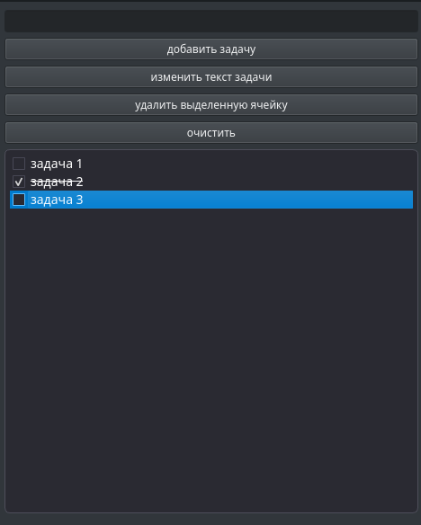

# 🗒️ Qt Todo List

Десктопное приложение для управления списком задач на **C++ / Qt Widgets**.  
Позволяет добавлять, удалять, редактировать и отмечать задачи выполненными.  
Данные сохраняются в файл и загружаются при следующем запуске.



> _Замени `screenshot.png` на свой скриншот. Положи картинку в корень проекта рядом с README._

---

## ✨ Возможности

- ➕ **Добавление** задач через поле ввода
- ✅ **Отметка** задачи как выполненной
- ✏️ **Редактирование** названия задачи
- 🗑️ **Удаление** выбранной задачи

---

## 🛠️ Технологии

- **Язык:** C++17
- **Фреймворк:** Qt 6 (Widgets)
- **Система сборки:** CMake
- **Среда разработки:** Qt Creator
- **ОС:** Linux / Windows / macOS

---

## 📦 Требования

Перед сборкой убедись, что установлено:

- **Qt 6** (пакеты `qt6-base-dev` и `qt6-tools-dev` на Linux)
- **CMake** версии 3.16 или выше
- **Компилятор C++** с поддержкой C++17 (g++ или clang++)
- **Qt Creator** (рекомендуется) или VS Code с расширением Qt
- **Необходимые зависимости** build-essential cmake qt6-base-dev qt6-tools-dev

### Установка зависимостей (Linux / Debian-based)

```bash
# 1. Перейти в папку проекта
cd qt_todo

# 2. Создать папку для сборки
mkdir build && cd build

# 3. Сконфигурировать проект
cmake ..

# 4. Собрать
make

# 5. Запустить
./QtTodo

```
